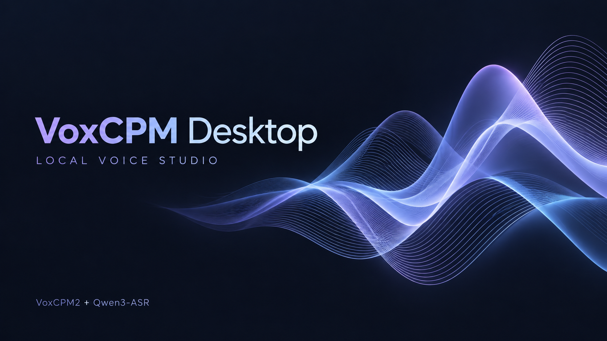

# VoxCPM Desktop

离线语音工作台：选择参考录音 → 自动识别原台词 → 输入想说的话 → 生成参考音色的语音。VoxCPM2 和 Qwen3-ASR 1.7B 随完整安装包提供，不需要另装 Python 或下载模型。

**1.0.0 首个预览版**。Mac Apple Silicon 已完成本机引擎测试；Windows x64 提供原生依赖与 CUDA 运行库，尚待 Windows 实机验收。该项目是社区桌面封装，与模型作者无隶属关系。

## 下载与安装

在 [Releases](../../releases) 下载对应平台名称下的所有 `.7z.001`、`.7z.002` 等分卷，放在同一个目录，使用 7-Zip 或 Keka 打开第一卷解压；不要逐卷解压。GitHub 的 Source code ZIP 只有源码，没有模型。

- **Mac Apple Silicon**：解压后打开 DMG，运行 VoxCPM Desktop；“安装与设备”会检测硬件，再选择“安装到本机”或直接使用。安装位置为个人 Applications 文件夹。
- **Windows x64**：解压后运行 `VoxCPM Desktop.exe`；检测通过后可安装到个人 Programs 文件夹，自动创建桌面快捷方式，也可便携运行。
- 尚未购买开发者证书或进行苹果公证。保持系统安全机制开启；只运行自己确认来源的包。
- 两个模型较大；安装器按实际完整包大小检查目标空间，另外保留 8 GiB 工作空间。

## 使用

1. 在“安装与设备”查看自动扫描结果，确认运行方式。
2. 输入目标台词，选择参考录音。自动转写原台词，允许手动校正。
3. 默认在识别后自动生成，也可关闭此选项、手动生成。结果只保存，不自动播放。
4. 长参考录音可指定起点，截取 1～30 秒。原文件不被修改。
5. 点击“停止”会终止模型进程，释放内存；识别与生成顺序执行。

支持 WAV、MP3、M4A、AAC、FLAC、OGG、OPUS、AIFF、WMA，以及 MP4/WebM 音轨。具体能否解码取决于文件实际编码。单文件最多 500 MB，单次目标文本最多 500 字。

## 配置判断

| 平台 | 支持范围 | 优先方式 |
| --- | --- | --- |
| macOS | Apple Silicon，macOS 13+ | Metal / MPS |
| Windows | x64，Windows 10 1809+ | NVIDIA CUDA，显存至少 8 GiB |

本封装采用至少 16 GB 物理内存的保守门槛，建议 32 GB。没有合适 GPU 可选 CPU，但速度较慢。硬件检查包含真实张量运算，不能保证所有输入在任何设备上都不会内存不足。Intel Mac、Windows ARM 暂无对应包。

## 数据与模型

音频、转写、输出和日志保存在本机应用数据目录，不上传。日志用于故障排查，包含本次输入和本地路径；分享日志前自行检查。选取参考音频只是本次参考，不会永久训练模型。

运行时仅访问本地模型，不需要账号。使用有权使用的参考录音，并避免将合成声音冒充真实录音。

## 源码与构建

参见 [构建说明](docs/BUILD.md)、[验证记录](docs/VALIDATION.md) 和 [第三方来源](docs/THIRD_PARTY.md)。模型的固定版本、大小及 SHA256 记录在 `models-manifest.json`；模型文件不进入 Git 历史。

桌面界面与封装采用 MIT；VoxCPM、VoxCPM2、Qwen3-ASR 保留 Apache-2.0 许可。其他依赖保留各自许可。封面由 OpenAI imagegen 生成，图标为项目自绘声波图形。
